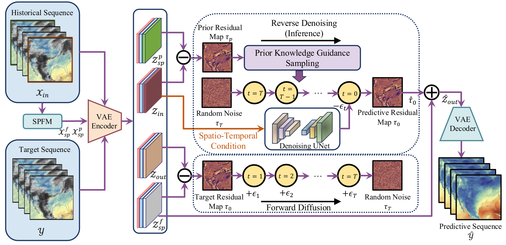

[Preprint](https://doi.org/10.2139/ssrn.6113906) · [GitHub repository](https://github.com/JOTYtao/DiffSolar)

## Research question

As forecast lead time increases, cloud evolution makes regional solar irradiance difficult to predict with a single deterministic trajectory.

## Approach

DiffSolar combines a smart-persistence baseline with a diffusion model that samples the stochastic residual fields. The denoiser conditions on multiscale spatiotemporal features, and the sampler uses statistics of regional residuals to guide generation.

*Figure from the DiffSolar preprint.*

[Original figure (PDF)](framework.pdf)

## Results

For four-hour-ahead forecasts on the satellite-derived benchmark, the public manuscript reports **105.9 W/m² RMSE** and a **continuous ranked probability skill score (CRPSS) of 0.367**.
