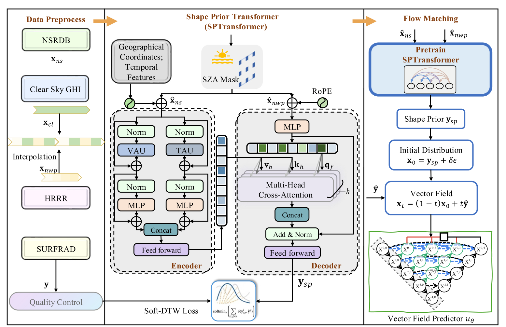

[Paper](https://doi.org/10.1016/j.egyai.2026.100887) · [GitHub repository](https://github.com/JOTYtao/SPFlow)

## Research question

Hourly numerical weather forecasts can miss short-lived irradiance changes that matter for reserves, storage scheduling, and PV integration.

## Approach

SPTransformer estimates a deterministic 15-minute shape prior from coarse weather predictions, satellite-derived meteorology, clear-sky irradiance, and site information. Conditional flow matching samples high-resolution trajectories around this prior to represent unresolved variability.

*Figure from the SPFlow paper.*

## Results

On SURFRAD, SPFlow improved **CRPS by up to 10.9%** relative to the strongest probabilistic baseline. The study also reports better ramp representation and near-nominal empirical interval coverage.
