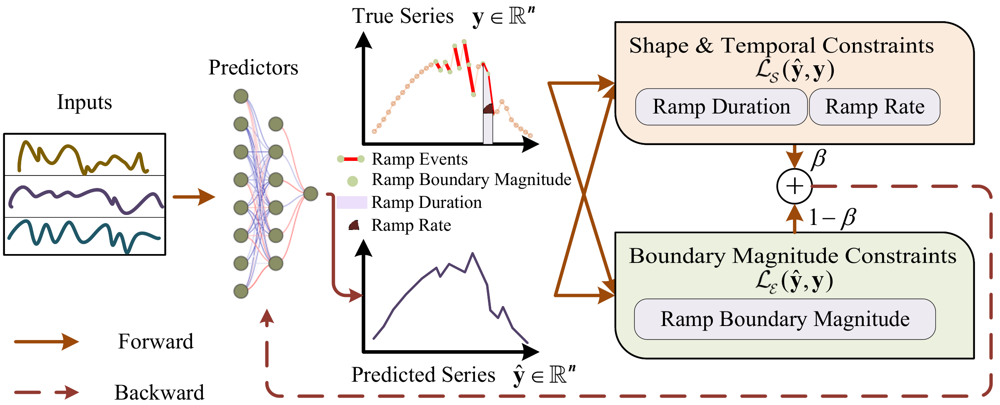

[Paper](https://doi.org/10.1016/j.egyai.2026.100881) · [GitHub repository](https://github.com/JOTYtao/RSTLoss)

## Research question

Rapid changes in solar irradiance can be mistimed or smoothed out when a forecasting model is trained mainly to minimize pointwise error.

## Approach

RSTLoss uses a differentiable, derivative-based alignment term to capture ramp shape and timing. A kernel based on extreme-value behavior increases sensitivity to the magnitude near ramp boundaries. The loss can be used with different forecasting architectures.

*Figure from the RSTLoss paper.*

[Original figure (PDF)](framework.pdf)

## Results

Across four BSRN datasets and five deep-learning models, the study reports improvements of up to **7.48% in Ramp Score** and **13.17% in Temporal Distortion Index** relative to the compared loss functions.
