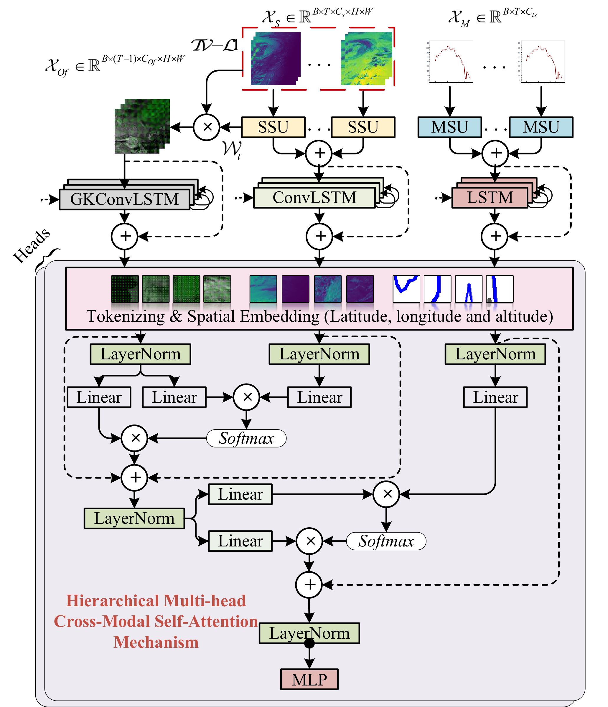

[Paper](https://doi.org/10.1109/TSTE.2024.3482360) · [GitHub repository](https://github.com/JOTYtao/SolarFusionNet)

## Research question

Intraday irradiance forecasts can draw on satellite observations and local meteorology, but useful features and their relationships change with weather conditions.

## Approach

Modality-specific selection units extract informative channels and variables. Recurrent encoders capture temporal structure, and a Gaussian-kernel ConvLSTM models sparse optical-flow cloud motion. Hierarchical cross-modal attention then combines the three streams.

*Figure from the SolarFusionNet paper.*

[Original figure (PDF)](framework.pdf)

## Results

For four-hour-ahead forecasts, the study reports **37.4–47.6% forecast skill** relative to smart persistence across the evaluated cases.
