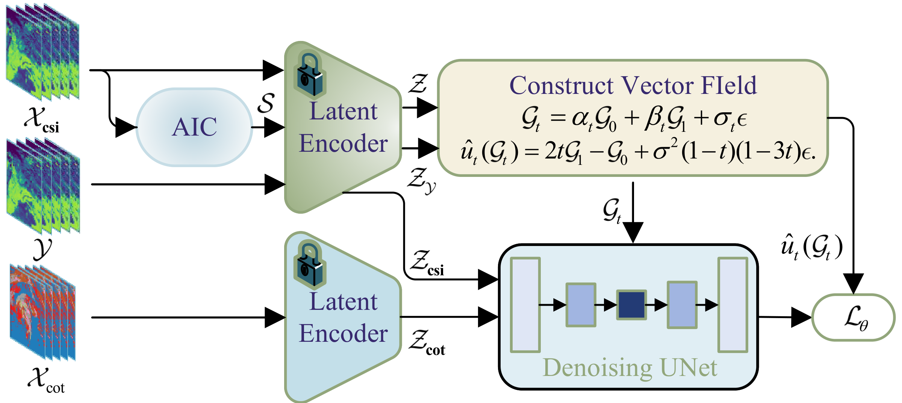

[Paper](https://doi.org/10.1109/TSTE.2026.3714841) · [GitHub repository](https://github.com/JOTYtao/WIP-Flow)

## Research question

Cloud advection explains part of a future irradiance field, but clouds also form, change shape, and dissipate. WIP-Flow forecasts the evolving distribution of regional surface solar irradiance from 30 minutes to four hours ahead.

## Approach

An optical-flow advection module with autoregressive correction constructs a weakly informative prior from recent cloud motion. A conditional latent flow-matching model uses satellite-derived clear-sky index and cloud optical thickness to generate ensemble members along a stochastic probability path.

*Figure from the WIP-Flow paper.*

[Original figure (PDF)](framework.pdf)

## Results

The paper reports a four-hour CRPS of **47.81 W/m²**. A 20-member regional ensemble took **26 seconds** on one NVIDIA A6000, a **4.96×** speedup over DiffSolar in the reported benchmark. Evaluation also included four independent ground stations and a downstream PV power forecasting task.
